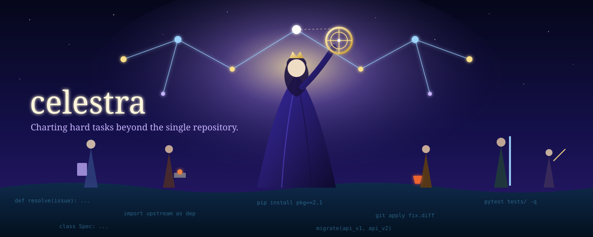
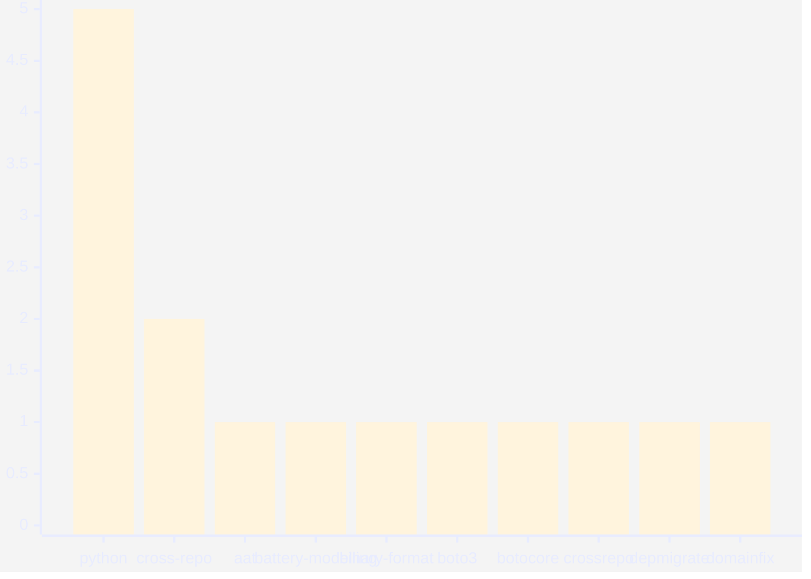
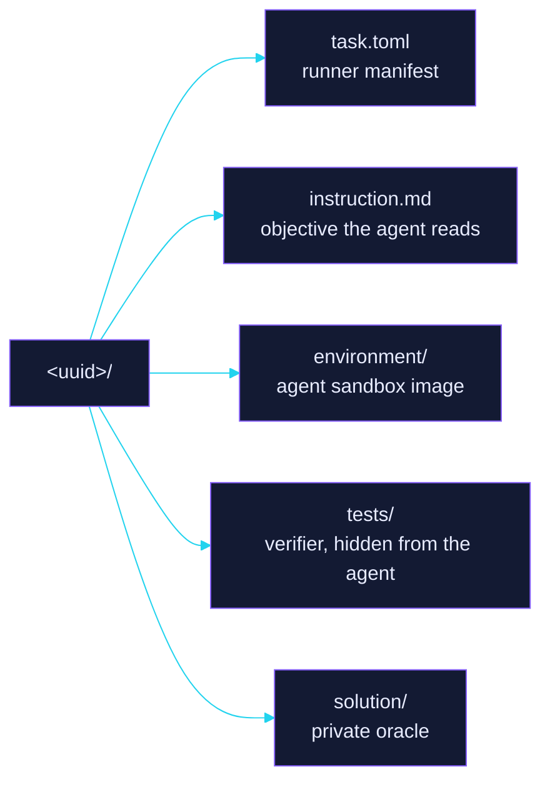

# celestra: samples

<b>The celestra samples lane: 5 of 5 Harbor task bundles.</b>

  

<a href="#research-paper">Research paper</a> | <a href="#research-problem-statement">Research problem statement</a> | <a href="#research-experimentation-design">Research experimentation design</a> | <a href="#task-overview">Task overview</a> | <a href="#harbor-format-walkthrough">Harbor format walkthrough</a> | <a href="#contact">Contact</a>

## Research paper

_Not yet written._

## Research problem statement

_Not yet written._

## Research experimentation design

_Not yet written._

## Task overview

The public sample of this corpus: at most 5 Harbor task bundles, anchors first, then in seal order.

Each bundle is one Harbor task in a directory named by its content-derived uuid5, so the name doubles as an integrity check. This page is rendered from the resident bundles on every reconcile; a value a bundle does not carry reads `absent`, and the page never fills one in.

| Property | Value |
| --- | --- |
| Bundles | 5 of 5 |
| Sealed | 2 of 5 |
| Registrations | sample (2), unregistered (3) |
| Audit verdicts | none (5) |
| Harbor schema | 1.4 (5) |

Pass rates are measured by the trials recorded in each bundle, not by a signed pilot, and no tier is claimed.

| Bundle | Model | Trials | Successes | pass@1 | pass@5 |
| --- | --- | --- | --- | --- | --- |
| 594fe341-7f10-5685-aeb1-ffa86424017d | claude-opus-5-5 | 1 | 0 | 0.00 | - |
| b82b72a4-cbcb-5dca-b5f6-be150573e37e | claude-opus-5-5 | 1 | 0 | 0.00 | - |
| e399ed3a-ba44-5777-b1bf-7cb0d481d40e | claude-opus-5-5 | 1 | 0 | 0.00 | - |
| 98258d6a-da32-5d91-b0cd-3d0bab26a467 | claude-opus-5-5 | 1 | 0 | 0.00 | - |
| 04312261-7c49-5547-aa9c-d00648750582 | claude-opus-5-5 | 1 | 0 | 0.00 | - |

The verdict is the audit outcome recorded at the sealed digest, and `none` means no verdict has landed for that digest yet. Only an authoring run removes a bundle from this lane, so removal waits for the next one.

| uuid | Verdict | Sealed digest | Stream |
| --- | --- | --- | --- |
| 594fe341-7f10-5685-aeb1-ffa86424017d | none | absent | none |
| b82b72a4-cbcb-5dca-b5f6-be150573e37e | none | absent | none |
| e399ed3a-ba44-5777-b1bf-7cb0d481d40e | none | absent | none |
| 98258d6a-da32-5d91-b0cd-3d0bab26a467 | none | `4f38b33c86e69b9b07c3cd5b7170ff57911093983234bf48427dc64e73455a55` | forge-mumukshu-panchal-ethara--20261028t140047z-e1803e |
| 04312261-7c49-5547-aa9c-d00648750582 | none | `ed8ffc749ea17402ae645b37b1b17d68b5eaf0e6b9fabb5d5141abaa3b40fa66` | forge-kshitijsharma-eth-20261104t221314z-1f4383 |

| Keyword | Bundles |
| --- | --- |
| python | 5 |
| cross-repo | 2 |
| aat | 1 |
| battery-modelling | 1 |
| binary-format | 1 |
| boto3 | 1 |
| botocore | 1 |
| crossrepo | 1 |
| depmigrate | 1 |
| domainfix | 1 |
| energy-systems | 1 |
| fonttools | 1 |
| human-in-the-loop | 1 |
| interrupt | 1 |
| langchain | 1 |
| langgraph | 1 |
| linopy | 1 |
| mort | 1 |
| morx | 1 |
| observability | 1 |
| ode-dae | 1 |
| opentype | 1 |
| optimization | 1 |
| pybamm | 1 |
| pypsa | 1 |
| sensitivities | 1 |
| sentry-python | 1 |
| tracing | 1 |

| Bundle | Task | Keywords | Registration | Sealed at |
| --- | --- | --- | --- | --- |
| [`594fe341-7f10-5685-aeb1-ffa86424017d`](594fe341-7f10-5685-aeb1-ffa86424017d/) | `ethara/594fe341-7f10-5685-aeb1-ffa86424017d` | cross-repo, human-in-the-loop, interrupt, langchain, langgraph, python | unregistered | unsealed |
| [`b82b72a4-cbcb-5dca-b5f6-be150573e37e`](b82b72a4-cbcb-5dca-b5f6-be150573e37e/) | `ethara/b82b72a4-cbcb-5dca-b5f6-be150573e37e` | boto3, botocore, cross-repo, observability, python, sentry-python, tracing | unregistered | unsealed |
| [`e399ed3a-ba44-5777-b1bf-7cb0d481d40e`](e399ed3a-ba44-5777-b1bf-7cb0d481d40e/) | `ethara/e399ed3a-ba44-5777-b1bf-7cb0d481d40e` | aat, binary-format, crossrepo, fonttools, mort, morx, opentype, python | unregistered | unsealed |
| [`98258d6a-da32-5d91-b0cd-3d0bab26a467`](98258d6a-da32-5d91-b0cd-3d0bab26a467/) | `ethara/98258d6a-da32-5d91-b0cd-3d0bab26a467` | depmigrate, energy-systems, linopy, optimization, pypsa, python | sample | 2026-11-04T06:02:00Z |
| [`04312261-7c49-5547-aa9c-d00648750582`](04312261-7c49-5547-aa9c-d00648750582/) | `ethara/04312261-7c49-5547-aa9c-d00648750582` | battery-modelling, domainfix, ode-dae, pybamm, python, sensitivities | sample | 2026-11-10T18:33:28Z |

## Harbor format walkthrough

| Entry | Role |
| --- | --- |
| `task.toml` | runner manifest |
| `instruction.md` | objective the agent reads |
| `environment/` | agent sandbox image |
| `tests/` | verifier, hidden from the agent |
| `solution/` | private oracle |
| `solution/trials/` | recorded trial outputs, hidden from the solver |

1. `task.toml` declares the schema, the metadata, the agent, and the environment.
2. `instruction.md` is what the agent reads.
3. `environment/` builds the sandbox the agent works in.
4. `tests/` grades the result.
5. `solution/` is the private oracle.
6. Run one bundle with Harbor against its directory: `harbor run -p <bundle> -a <agent> -e docker`.

Each bundle directory is a complete Harbor task: `task.toml` is the runner manifest, `instruction.md` the objective, `environment/` the sandbox image, and `tests/` the verifier. Point a Harbor runner at one bundle directory to reproduce it; `solution/` stays private.

## Contact

[research@ethara.ai](mailto:research@ethara.ai)

Copyright (c) 2026 Green Rider Technology LLP (Ethara AI). All rights reserved.
